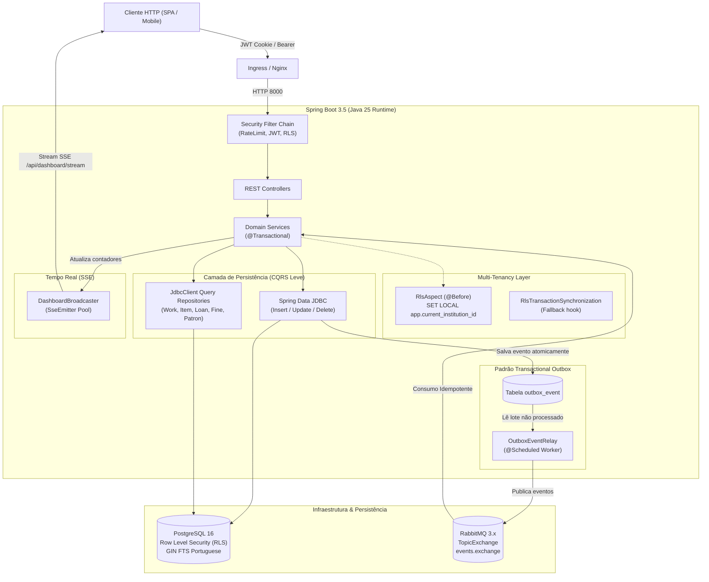

# 📚 Sistema de Gestão de Bibliotecas Escolares (API REST)

[](https://openjdk.org/)
[](https://spring.io/projects/spring-boot)
[](https://www.postgresql.org/)
[](https://www.rabbitmq.com/)
[](https://flywaydb.org/)
[](https://www.docker.com/)
[](https://k3s.io/)

> **Microsserviço de Backend:** API REST corporativa desenvolvida para a rede de bibliotecas escolares públicas (Rede E.E.E.P.), implementando arquitetura orientada a eventos, isolamento multi-tenant a nível de banco de dados (Row Level Security), Transactional Outbox, busca textual de alta performance com PostgreSQL FTS e comunicação reativa em tempo real com Server-Sent Events (SSE).

🌐 **Repositório do Frontend SPA:** [react-mui-biblioteca](https://github.com/fabriciosouza0/react-mui-biblioteca) (React 18, TypeScript, Vite, Material UI 6, TanStack Query).

---

## 🏛️ Visão Geral da Arquitetura

O sistema adota os princípios de **Domain-Driven Design (DDD)**, **Clean Architecture** e **CQRS Leve**, priorizando alta performance com **Spring Data JDBC** e **JdbcClient** em vez de abstrações pesadas de ORMs tradicionais:



---

## 💎 Destaques de Engenharia & Decisões Arquiteturais

### 1. Isolamento Multi-Tenant com PostgreSQL Row Level Security (RLS)

Diferente de abordagens frágeis onde cada consulta precisa incluir manualmente cláusulas `WHERE institution_id = :id` (sujeitas a erro humano e vazamento de dados entre escolas), este projeto implementa **Row Level Security nativo no kernel do PostgreSQL** ([ADR 012](file:///C:/Users/derp_/OneDrive/Documents/Biblioteca%20-%2002/docs/adr/backend/012-multi-tenancy.md) e [ADR 017](file:///C:/Users/derp_/OneDrive/Documents/Biblioteca%20-%2002/docs/adr/backend/017-x-institution-id-header.md)).

#### Defesa em Profundidade (Tripla Camada):
1. **`RlsFilter` (`com.escola.biblioteca.security.RlsFilter`):** Intercepta cada requisição HTTP, extrai o contexto do token JWT e o cabeçalho `X-Institution-Id`, validando a associação do usuário com a instituição ativa e injetando as variáveis no escopo da requisição.
2. **`RlsAspect` (`com.escola.biblioteca.config.RlsAspect`):** Intercepta anotações `@Transactional` via Spring AOP e, antes de executar qualquer instrução de negócio, obtém a conexão física ativa do `DataSourceUtils` e injeta variáveis de sessão locais da transação:
   ```sql
   SET LOCAL app.current_institution_id = 'c38a1bf2-e981-420a-9d6e-98b71d9d401a';
   SET LOCAL app.is_global_admin = 'false';
   SET LOCAL app.current_adm_codigo = 'USR-001';
   ```
3. **`RlsTransactionSynchronization` (`com.escola.biblioteca.config.RlsTransactionSynchronization`):** Hook de sincronização registrado como fallback para operações transacionais internas fora do proxy AOP padrão.
4. **Políticas SQL Declarativas (`V8__rls_policies.sql`):** As tabelas `institution`, `patron`, `work`, `item`, `loan`, `hold`, `fine` e `outbox_event` possuem políticas estritas:
   ```sql
   CREATE POLICY item_select ON item
       FOR SELECT USING (is_global_admin() OR institution_id = current_institution_id());
   ```
   > 🔒 **Garantia de Segurança:** Mesmo que uma consulta `SELECT * FROM item` seja executada sem filtros, o PostgreSQL retorna **exclusivamente** os registros pertencentes à instituição da conexão ativa.

---

### 2. Transactional Outbox & Processamento Assíncrono com Workers

Para evitar o clássico problema de inconsistência distribuída (**Dual-Write Problem**) ao gravar dados no banco e emitir mensagens no broker:

1. **Persistência Atômica:** Quando um empréstimo ou devolução ocorre, a mutação da entidade e o registro do evento de domínio na tabela `outbox_event` ocorrem na **mesma transação relacional JDBC ACID**.
2. **`OutboxEventRelay` (`com.escola.biblioteca.domain.outbox.relay`):** Um componente agendado (`@Scheduled(fixedDelay = 2000)`) pesquisa lotes de eventos pendentes (`findByProcessedAtIsNullOrderByCreatedAtAsc`), publica no RabbitMQ (`TopicExchange` com chaves de roteamento `circulation.loan`, `circulation.hold`, `circulation.fine`) e marca `processed_at = NOW()`.
3. **Consumidores Idempotentes:** `AbstractIdempotentConsumer` e `ProcessedEventRepository` garantem semântica de entrega *at-least-once* com processamento estrito *exactly-once*, deduplicando mensagens via UUID do evento.
4. **Schedulers e Manutenção em Lote:** `BatchJobRunner` e `CirculationJobService` executam rotinas críticas (cálculo de multas vencidas, expiração de reservas não retiradas) desacopladas da API web principal. Em containers, o backend pode rodar em modo servidor (`APP_WORKER_ENABLED=false`) e em modo worker autônomo (`APP_WORKER_ENABLED=true`), ou via **Kubernetes CronJobs** dedicados.

---

### 3. Separação CQRS & PostgreSQL Full-Text Search (FTS)

O projeto separa as responsabilidades de escrita e leitura para ganho expressivo de vazão:

- **Comandos (Write Model):** Entidades estruturadas com **Spring Data JDBC** e migrações incrementais determinísticas via **Flyway** (V1 a V8).
- **Consultas (Read Model):** Repositórios de consulta especializados (`WorkQueryRepository`, `ItemQueryRepository`, `LoanQueryRepository`, `PatronQueryRepository`, `FineQueryRepository`, `HoldQueryRepository`) utilizando `JdbcClient` nativo com projeções diretas em DTOs enriquecidos, eliminando problemas de N+1 e proxies preguiçosos (*LazyInitializationException*).
- **Busca Textual em Português (`V3__fts_search.sql`):**
  - Índices GIN sobre vetores léxicos com stemming nativo em português:
    ```sql
    CREATE INDEX idx_livro_titulo_fts ON livro USING GIN (to_tsvector('portuguese', titulo));
    ```
  - Consultas inteligentes com prefixos e operadores booleanos via `websearch_to_tsquery('portuguese', :term || ':*')`, permitindo buscas instantâneas e tolerantes a variações gramaticais.

---

### 4. Tempo Real Reativo com Server-Sent Events (SSE)

O painel de monitoramento e contadores de circulação não realiza polling constante contra a API:

- **`DashboardBroadcaster` (`com.escola.biblioteca.dashboard`):** Gerencia um pool concorrente thread-safe (`ConcurrentHashMap.KeySetView`) de emissores `SseEmitter` conectados.
- **Heartbeat e Resiliência:** Heartbeat automático a cada 15 segundos (`app.sse.heartbeat-ms`) para impedir que proxies reversos (Nginx / Ingress) derrubem conexões inativas.
- **Isolamento por Tenancy:** Atualizações acionadas por eventos de circulação despacham métricas consolidadas exclusivamente para os clientes inscritos na instituição afetada.

---

### 5. Segurança em Camadas & Stateless JWT

- **Armazenamento Seguro de Tokens:** O Refresh Token é transportado exclusivamente através de **Cookies HTTP-Only** (`SameSite=Strict`, flag `Secure` configurável), imunes a ataques XSS. O Access Token possui ciclo de vida curto (7 minutos).
- **Rotação de Refresh Tokens:** A cada requisição de `/api/auth/refresh`, um novo par de tokens é emitido e o anterior é revogado no banco, detectando tentativas de reuso malicioso.
- **Rotação de Segredo sem Downtime:** O `JwtService` suporta simultaneamente `JWT_SECRET` e `JWT_PREVIOUS_SECRET`, permitindo trocar chaves criptográficas em produção sem deslogar usuários ativos.
- **Proteção contra Força Bruta com `RateLimitFilter`:** Algoritmo *Token Bucket* em memória por IP com capacidades customizáveis (ex.: 5 req/min para `/api/auth/login` e 10 req/min para `/api/auth/refresh`), retornando HTTP 429 quando excedido.

---

### 6. Observabilidade & Documentação Viva

- **Spring Boot Actuator:** Endpoints `/actuator/health/liveness` e `/actuator/health/readiness` prontos para probes de orquestração do Kubernetes, além de métricas JVM e pool HikariCP.
- **OpenAPI 3 / Swagger:** Especificação viva com schemas e exemplos interativos acessíveis em `/swagger-ui.html`.

---

## 🚀 Como Executar o Projeto Localmente

### Estrutura de Pastas Lado a Lado (Multi-Repo)

Para permitir a orquestração completa em desenvolvimento local, os dois repositórios do GitHub devem ser clonados lado a lado sob uma mesma pasta raiz:

```
workspace/
├── sboot-api-biblioteca/       # Repositório Backend (este projeto)
│   ├── .env.example            # Template de variáveis de ambiente
│   ├── .env                    # Arquivo de segredos local (ignorado no .gitignore)
│   ├── docker-compose.yml      # Orquestrador local multi-serviço
│   ├── Dockerfile              # Multi-stage Maven -> Eclipse Temurin 25 JRE
│   ├── pom.xml
│   └── k8s/                    # Manifestos Kubernetes para k3s/k3d
└── react-mui-biblioteca/       # Repositório Frontend (SPA React + MUI)
    ├── Dockerfile              # Multi-stage Node 20 -> Nginx Alpine
    └── package.json
```

> 💡 **Como o Docker Compose localiza o Frontend:**  
> O `docker-compose.yml` reside na raiz do **`sboot-api-biblioteca`**. O serviço do frontend está configurado com `context: ../react-mui-biblioteca`, referenciando o diretório irmão um nível acima (`../`). Assim, ambos os projetos são construídos e integrados mantendo seus repositórios Git 100% desacoplados.

> [!WARNING]
> **Atenção aos nomes das pastas (Convenção Multi-Repo):**  
> O `docker-compose.yml` assume estritamente o caminho relativo `../react-mui-biblioteca`. Se você clonar o frontend com um nome de pasta customizado (por exemplo, `frontend-biblioteca`), **será obrigatório ajustar a propriedade `context: ../react-mui-biblioteca`** dentro do `docker-compose.yml` para coincidir com o nome do diretório escolhido, caso contrário o Docker reportará erro informando que o diretório de build não foi encontrado.

---

### Passo 1: Clonar os Repositórios e Configurar Segredos

```bash
# 1. Clone ambos os repositórios na mesma pasta:
git clone https://github.com/fabriciosouza0/sboot-api-biblioteca.git
git clone https://github.com/fabriciosouza0/react-mui-biblioteca.git

# 2. Entre na pasta do backend:
cd sboot-api-biblioteca

# 3. Crie seu arquivo .env a partir do template:
cp .env.example .env

# 4. Gere uma chave segura de 256 bits para o JWT:
openssl rand -base64 32
# Cole a chave gerada no campo JWT_SECRET do arquivo .env
```

---

### Passo 2: Execução com Docker Compose (Recomendado)

Estando dentro da pasta `sboot-api-biblioteca`, execute:

```bash
docker compose up -d
```

O Compose carregará automaticamente o `.env` local, construirá as imagens do backend (`context: .`) e do frontend (`context: ../react-mui-biblioteca`) e inicializará todos os serviços:

#### Serviços Inicializados:
| Serviço | Contêiner | Porta Externa | Função |
| :--- | :--- | :--- | :--- |
| **PostgreSQL** | `biblioteca-postgres` | `5432` | Banco relacional com extensões FTS e RLS ativo |
| **RabbitMQ** | `biblioteca-rabbitmq` | `5672` / `15672` | Broker AMQP e painel web de filas |
| **Backend API** | `biblioteca-backend` | `8000` | Servidor HTTP REST (Spring Boot 3.5 / Java 25) |
| **Worker** | `biblioteca-worker` | - | Relay Outbox e consumidor assíncrono desacoplado |
| **Frontend** | `biblioteca-frontend` | `80` | Interface SPA React servida via Nginx |

---

### Passo 3: Execução Manual / Desenvolvimento Local (Maven)

Se desejar executar a infraestrutura no Docker e rodar o Backend localmente na IDE:

```bash
# 1. Suba apenas o PostgreSQL e o RabbitMQ via Compose:
docker compose up -d postgres rabbitmq

# 2. Inicie a aplicação Spring Boot:
mvn clean spring-boot:run
```

---

### Passo 4: Execução em Kubernetes Local (`k3s` / `k3d`)

O projeto está pronto para ambientes Kubernetes leves:

```bash
# 1. Criar cluster k3d (caso utilize k3d):
k3d cluster create biblioteca -p "8000:8000@loadbalancer" -p "80:80@loadbalancer"

# 2. Aplicar os manifestos da pasta k8s/:
kubectl apply -f k8s/namespace.yaml
kubectl apply -f k8s/secrets.yaml
kubectl apply -f k8s/configmap.yaml
kubectl apply -f k8s/postgres-statefulset.yaml
kubectl apply -f k8s/backend-deployment.yaml
kubectl apply -f k8s/backend-service.yaml
```

---

## 🔍 URLs Úteis & Credenciais de Demonstração

Com o ambiente em execução:

- **Aplicação Web (Frontend):** [http://localhost](http://localhost)
- **API REST (Backend):** [http://localhost:8000](http://localhost:8000)
- **Documentação Interativa (Swagger UI):** [http://localhost:8000/swagger-ui.html](http://localhost:8000/swagger-ui.html)
- **OpenAPI Schema (JSON):** [http://localhost:8000/v3/api-docs](http://localhost:8000/v3/api-docs)
- **Health Check (Actuator):** [http://localhost:8000/actuator/health](http://localhost:8000/actuator/health)
- **Painel RabbitMQ:** [http://localhost:15672](http://localhost:15672) *(Usuário: `guest` | Senha: `guest`)*

### Credenciais Padrão de Teste (Carregadas via Flyway)
| Perfil | Usuário / E-mail | Senha | Escopo |
| :--- | :--- | :--- | :--- |
| **Global Admin** | `admin` | `admin123` | Acesso cross-tenant total à rede de ensino |
| **Institution Admin** | `bibliotecario.escola1` | `admin123` | Isolamento estrito à biblioteca vinculada |

---

## 🧪 Testes Automatizados

A suíte de testes cobre unitários de domínio, testes de repositório, validação das políticas RLS e controllers:

```bash
# Executar todos os testes:
mvn clean test

# Executar apenas testes de integração e RLS:
mvn test -Dtest=*Rls*Test
```

---

## 📄 Licença

Este projeto foi desenvolvido para fins educacionais, de modernização do setor público e demonstração de arquitetura de software de nível sênior.
